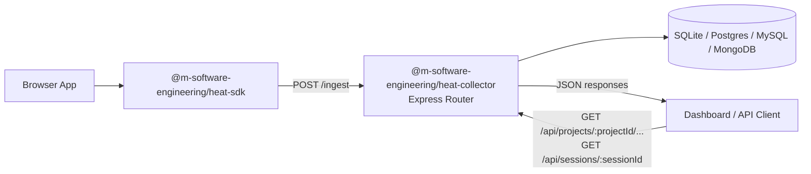
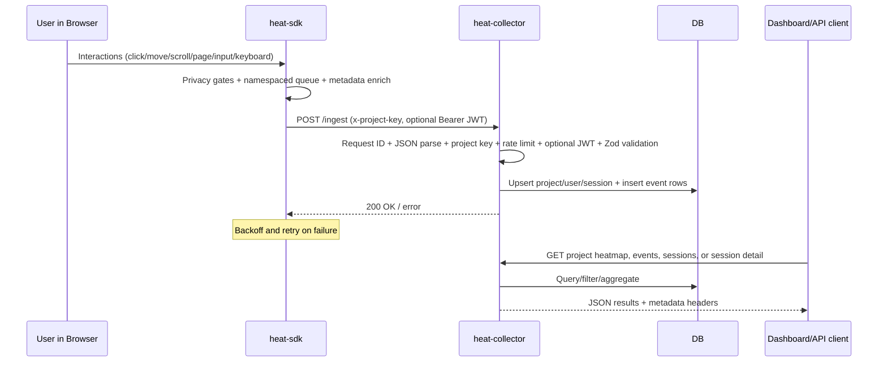

# heat-tracker Monorepo Architecture

## 1) Purpose

`heat-tracker` is an end-to-end product analytics stack that captures browser interaction events in a client SDK, ingests them through an HTTP collector, stores them in SQLite, Postgres, MySQL, or MongoDB, and exposes query APIs for heatmaps/session analysis and dashboards.

Primary goals observed in code:

- Browser-side event capture with privacy-aware defaults (`packages/heat-sdk`).
- Backend ingestion, validation, auth, persistence, and analytics APIs (`packages/heat-collector`).
- Runnable references for local stack + UI exploration (`examples/*`, `e2e/*`).

## 2) Monorepo map

| Path                         | Role                                                                  |
| ---------------------------- | --------------------------------------------------------------------- |
| `packages/heat-sdk`          | Browser SDK package (`@m-software-engineering/heat-sdk`).             |
| `packages/heat-collector`    | Express collector package (`@m-software-engineering/heat-collector`). |
| `packages/heat-errors`       | Zero-dependency `HEAT_E_*` error catalog shared by SDK and collector. |
| `docs/errors.md`             | Error reference generated from the `heat-errors` catalog.             |
| `examples/express-collector` | Minimal app that mounts collector router.                             |
| `examples/nextjs-dashboard`  | Reference dashboard consuming collector APIs.                         |
| `examples/docker-compose`    | Local MySQL/Postgres bootstrap for SQL adapter testing.               |
| `e2e`                        | Playwright E2E validating SDK + collector integration.                |
| `package.json`               | Workspace-level build/test/lint/typecheck commands.                   |
| `pnpm-workspace.yaml`        | Declares workspace packages under `packages/*` and `examples/*`.      |

Discovered package roots for architecture docs:

- SDK: `packages/heat-sdk/ARCHITECTURE.md`
- Collector: `packages/heat-collector/ARCHITECTURE.md`

## 3) System architecture

Component responsibilities:

- **SDK**: capture click/move/scroll/pageview/custom (+ optional input/keyboard), apply privacy gates, namespace session/queue storage per project+endpoint, batch, retry/backoff, flush, and send payloads.
- **Collector**: assign request IDs before body parsing, validate payload/query schemas, enforce ingest auth/rate limits, write project/user/session/event rows, expose query endpoints and metrics.
- **Storage**: adapter pattern for SQL dialects and MongoDB.

## 4) Package relationships

- Dependency direction: `heat-sdk` is independent and publishes payloads over HTTP; `heat-collector` consumes those payload contracts via runtime validation (Zod). There is no direct package import from collector to SDK.
- Coupling boundary: the ingestion payload schema and event type semantics (`click`, `move`, `scroll`, etc.) are the primary contract.
- Both packages use `@m-software-engineering/heat-errors` (zero runtime deps) for one error shape. The collector depends on it at runtime; the SDK bundles the entries it uses at build time (`tsup.noExternal`), so its browser ESM build stays dependency-free (≈ +1 KB min+gzip). Shape: `{ code: HEAT_E_*, message, cause, fix, docs, requestId?, status?, details? }`. The collector answers `{ error: HeatError }` (the old top-level `error` string is gone). It keeps the deprecated top-level `code`/`message`/`requestId`/`details` until the next major, sends `Deprecation: true` plus a `Link` to `docs/errors.md#migrating-from-legacy-fields` (only on responses that carry the legacy fields), and logs one deprecation warning per process naming each replacement. It cannot see which fields clients read, so it warns on the first error response. `POST /ingest` with a missing or non-JSON Content-Type returns 415. `collector.router` never answers unknown paths, so host routes registered after it (even under `/api`) keep working; hosts opt into a JSON 404 by mounting `collector.notFoundHandler` last. Known follow-up (#49): the SDK still requeues definitive 4xx responses (e.g. 400/401/415) with backoff instead of dropping the batch. The SDK passes collector errors to `onError`. The catalog is split per surface (`sdk`, `ingest`, `query`, `server`) so the SDK only pulls its own entries, and `docs/errors.md` is regenerated with `corepack pnpm -C packages/heat-errors docs:errors` (a unit test fails when it is stale).
- Integration appears intentionally loose (HTTP + schema), but schema drift risk exists because event types are duplicated between packages rather than centrally shared.

## 5) Data/control flow

## 6) Build and execution model

Workspace-level commands:

- `pnpm verify`
- `pnpm format:check`
- `pnpm build`
- `pnpm dev`
- `pnpm typecheck`
- `pnpm lint`
- `pnpm test`
- `pnpm test:coverage`
- `pnpm test:e2e`
- `pnpm check:deps`
- `pnpm check:arch`
- `pnpm check:pkg`

Package-level highlights:

- SDK and collector both use `tsup` for build and `vitest` for tests.
- The collector validates both ESM and CommonJS distribution entrypoints against an in-memory SQLite database after its unit and coverage suites.
- Collector CLI binaries: `heat-collector-migrate` (runs `autoMigrate` with env-based dialect/connection) and `heat-collector` (self-hosted server: `serve` on port 4000 with the read API behind an admin token stored in `HEAT_DATA_DIR`, `token` to print it; see `packages/heat-collector/ARCHITECTURE.md`).
- The deterministic quality harness is centered on `pnpm verify`, which chains formatting, ESLint, TypeScript, builds, coverage, Playwright, Knip, dependency-cruiser, publint, Are The Types Wrong, and API Extractor.
- The reference dashboard draws the click heatmap over the live page (#27): `components/PageHeatmap.tsx` frames the site (`sandbox="allow-same-origin allow-scripts"`, pointer events off) at the recorded viewport width, inside one scroll container with the canvas, so overlay and page scroll together without drift. Framing is checked server-side by `app/api/frame-check` (`lib/frame-policy.ts`: CSP `frame-ancestors` first, then `X-Frame-Options`), because a blocked cross-origin frame looks the same as an allowed one in the browser (catalog `DASHBOARD_ERRORS`). `lib/heatmap-render.ts` bins points on a ≤ 400 k-cell grid, box-blurs and colors them with a viridis palette in yielding chunks (100 k points ≈ 45 ms, no long task). A "Top clicked areas" table is the text alternative. View choices (viewport, opacity, heatmap on/off, table, period) live in the URL. `e2e/heatmap-overlay.e2e.spec.ts` mounts the component without Next.js (tsup bundle) against a real collector and a cross-origin site, and also covers alignment, the render budget and axe; `e2e/frame-handshake.e2e.spec.ts` covers the handshake states, forged messages and `frame-src`. The frame-check route only fetches origins allowlisted in `HEAT_DASHBOARD_SITE_ORIGINS` (2.5 s timeout, headers only); redirects are followed by hand (`redirect: "manual"`, at most 5 hops) and every hop is checked against the allowlist, so it cannot be used as an open SSRF proxy. Allowlist entries that are not plain origins (wildcards included) are skipped with a `HEAT_E_FRAME_ORIGIN_INVALID` warning. `FrameVerdict` is a discriminated union on `verified`: a verified result has `blocked` and a `detail` but no `reason`; a timeout or unreachable site is `{ verified: false, reason: "timeout" | "unreachable" }`. Since #59 the iframe's `load` event is not used (Chromium fires it for its own error page). A verified `blocked` verdict (X-Frame-Options or CSP `frame-ancestors`) shows `HEAT_E_FRAME_BLOCKED` with its fix at once, without framing. Otherwise (allowed or inconclusive) the page is framed, hidden behind the skeleton, and only the SDK handshake counts (`lib/frame-handshake.ts`, `lib/use-frame-handshake.ts`, listener attached in a layout effect before the frame loads). `init()` posts `{ type: "heat-tracker:frame-hello", href: origin + pathname }` (no query or hash) only to the origins in its `dashboardOrigins` option, each as the exact `targetOrigin`; without the option, or with Do Not Track on, it sends nothing. The pathname goes through `sanitizePathname` (`privacy-rules.ts`, byte-identical in the SDK, the collector and `examples/nextjs-dashboard/lib/privacy-rules.ts`); the dashboard compares against the masked expected path and masks again before showing or logging any URL (`maskedUrl`), so the raw path never appears in the redirect notice or `console.warn`. The no-response notice wraps `dashboardOrigins` in `<code>` as a React element (the catalog keeps plain text). The onboarding snippet (`lib/onboarding.ts`) fills in `dashboardOrigins: [<dashboard origin>]`, with every value escaped by `JSON.stringify` (`<` as `\u003c`). The dashboard accepts a hello only when `event.source` is the iframe's window and `event.origin` is the page's origin or in the allowlist (the route returns it as `allowedOrigins`), and the `href` agrees with that origin. No valid hello within 8 s shows `HEAT_E_FRAME_NO_RESPONSE` ("This page didn't respond. Check that the heat-tracker snippet is installed with this dashboard in dashboardOrigins, that the site allows framing, and that Do Not Track is off in this browser.", with an "Open page in new tab" link, `rel="noopener noreferrer"`); the listener stays on, so a late hello still recovers. A hello from another host or path shows `HEAT_E_FRAME_REDIRECTED` with the URL as a text node and hides the heatmap. SPA navigation inside the frame after the hello is not detected (known limitation). Details (header verdict, URLs) go to `console.warn` only, never into the visible notice. `middleware.ts` sends `Content-Security-Policy: frame-src <HEAT_DASHBOARD_SITE_ORIGINS>` (`'none'` when empty). A bad or too long redirect chain (`reason: "redirect"`) or no answer from the dashboard's own route (client 3 s budget, error; `reason: "check-failed"`) still fails closed: the page is not framed and `HEAT_E_FRAME_CHECK_UNVERIFIED` is shown; other origins are never framed and show `HEAT_E_FRAME_ORIGIN_NOT_ALLOWED` with the allowlist line to copy. The viewport toggle sends the collector's `viewport` filter (every stored bucket of the class from `meta.viewportBuckets`, busiest first so it sets the frame width), and the frame scales down to fit narrow containers.
- Entry point (#25): the dashboard home lists projects (`GET /api/projects`), then a project's popular pages by title (`GET /api/projects/:projectId/pages`, last 7 days by distinct pageview sessions), and a row opens the heatmap. The SDK sends `document.title` on pageviews and drops the query string unless allowlisted (`privacy.keepQueryParams`); the collector strips sensitive params again on every ingest (token rule shared byte-for-byte with the SDK in `privacy-rules.ts`, table in `fixtures/privacy-cases.json`), drops `;matrix` params and masks email path segments as `[email]`; `/ingest` accepts only `[A-Za-z0-9_-]{1,128}` project keys and the snippet escapes them. `GET /api/projects` returns `projectKey` (admin-only) so the empty state shows the snippet in any browser. Dashboard: `components/ProjectList.tsx`, `components/PopularPages.tsx` (skeleton rows, real links, arrow keys, "Waiting for your first event…" poll), shared `components/EntryTable.tsx`; covered by `e2e/entry-pages.e2e.spec.ts`. Admin-token auth for these routes and the install snippet in the empty state come from #24.
- Self-hosting (#24): root `docker-compose.yml` runs `postgres` (named volume, not published), `collector` (`ghcr.io/m-software-engineering/heat-collector:<pinned version>`, port 4000, admin token in the `collector-data` volume, healthcheck on `/healthz`) and `dashboard` (`ghcr.io/m-software-engineering/heat-dashboard:<pinned version>`, port 3000, starts after the collector is healthy). Every service is `read_only`, `no-new-privileges`, `cap_drop: ALL`, and the app images run as `node`. `compose.dev.yml` overrides both app images with local builds from `packages/heat-collector/Dockerfile` and `examples/nextjs-dashboard/Dockerfile` (build context: repo root). The collector image ships one bundled file (`packages/heat-collector/scripts/bundle-server.mjs`, pure-JS drivers inlined, no SQLite); the dashboard image is the Next.js `standalone` output. Images are published to GHCR by CD on release (ops); this repo does not publish them yet. The dashboard keeps the admin token in an HttpOnly `SameSite=Strict`, `Path=/` cookie (`app/api/session`; `__Host-heat_admin` + `Secure` when the request is HTTPS, `X-Forwarded-Proto: https`, or `HEAT_DASHBOARD_SECURE_COOKIE=true`, else `heat_admin`, which browsers share across ports of the same host). `POST /api/session` requires `application/json` (`HEAT_E_DASHBOARD_CONTENT_TYPE`, 415) and an `Origin` equal to the dashboard's own origin: `HEAT_DASHBOARD_URL` when set (validated at startup by `instrumentation.ts`, `HEAT_E_CONFIG_INVALID`; an `https://` value also forces the `__Host-` cookie), else `Host`/`X-Forwarded-*` (`HEAT_E_DASHBOARD_ORIGIN`, 403), and its server proxies read-only `GET /api/collector/api/*` to the collector with the token (`lib/collector-proxy.ts`), so the token never reaches browser JS. The onboarding page generates a projectKey (localStorage), shows the SDK snippet with a copy button, and polls `GET /api/projects/by-key/:key` every 3 s (paused while `document.hidden`, #29) until the first ingest creates the project. Compose reads optional settings from `.env` (`${VAR:-default}`: `HEAT_PUBLIC_COLLECTOR_URL`, `HEAT_DASHBOARD_URL`, `HEAT_ADMIN_TOKEN`, `HEAT_TRUST_PROXY`, `HEAT_DASHBOARD_SECURE_COOKIE`, `POSTGRES_PASSWORD`); `.dockerignore` excludes `.env*`. Until GHCR images are published, the README quick start uses `-f compose.dev.yml`; the pinned `0.4.0` tags stay (the release script rewrites them). `e2e/dashboard-session.e2e.spec.ts` covers the cookie and proxy against a real `heat-collector` server; `e2e/compose.e2e.spec.ts` (opt-in `HEAT_COMPOSE_E2E=1`, run by `.github/workflows/compose-smoke.yml`) runs the README quick start on the real stack and asserts the ≤ 120 s cold start.
- Dashboard shell (#29): `components/AppShell.tsx` gives every route a "Skip to content" link, two nav items (Projects, and Pages for the current or last-opened project; the dead Sessions link is gone), one `h1` and a unique `<title>`. The flow is sign in (`TokenForm`, `CollectorUnreachable`) → projects (`ProjectList`, empty state "Create your first project") → new project (`?new`, `Onboarding`: no name field, the project is named from the site's origin on its first event and the heading reads "New project" until then; snippet with a 2 s "Copied" and the `LiveCheck` status, polled every 3 s only while the tab is visible via `lib/use-first-event.ts`, "Still nothing…" after 2 min) → pages → heatmap. A bare `/` reopens the last-opened project (`lib/last-project.ts`, localStorage). All spec copy, including nav, headings and labels, lives in `lib/copy.ts` (EN and PT-BR verbatim; the pages empty text follows the selected period, "24 hours" for 1 day; the sampled heatmap says "Showing a sample of the data" because `meta.total` counts events, not visits; PT-BR when `navigator.language` starts with `pt`, `lib/use-locale.ts`); numbers and dates use that locale. Errors render through `components/ErrorPanel.tsx` (`role="alert"`, message, fix, focused Retry, "Copy details" with code + requestId). `e2e/dashboard-shell.e2e.spec.ts` mounts each state via the harness (`?shell=<state>&lang=pt`, `test/shell-states.ts`) and runs axe-core on all of them in both locales.
- `.github/workflows/heatmap-db.yml` runs the heatmap golden test on real Postgres, MySQL and MongoDB plus the 1 M-event Postgres bench (p95 ≤ 500 ms, flat RSS), nightly and on PRs touching `packages/heat-collector/src/**`, its `package.json`, `bench/**`, `vitest.config.ts` or `tsconfig*.json`, `packages/heat-errors/**`, root `package.json`, `tsconfig.base.json`, `pnpm-workspace.yaml`, `fixtures/**`, `pnpm-lock.yaml` or the workflow (decided by a `dorny/paths-filter` job, not trigger `paths`); the always-run `golden-status` job passes when Golden passed or was skipped as irrelevant, so it can be a required check.
- GitHub Actions separates PR verification from release publishing: `ci.yml` runs full `pnpm verify` on Node 22 and `pnpm verify:non-e2e` on Node 24 for pull requests, while `cd.yml` runs the Changesets release flow only on pushes to `main` after merges. CI preinstalls Chromium only for the Node 22 browser job because the Playwright suite targets Chromium, emits one aggregate Markdown quality summary from uploaded artifacts, and CodeQL remains handled by GitHub default setup so the repository does not upload duplicate advanced-setup CodeQL SARIF. CD uses npm trusted publishing with short-lived GitHub OIDC credentials instead of a long-lived registry token, and emits a Markdown release summary from Changesets outputs and package manifests. Published package manifests declare the monorepo and their workspace directory so npm can verify the workflow identity.
- Security workflows pin executable actions to immutable commits. Semgrep scans the full repository, pnpm applies minimum-release-age, exotic-subdependency, and trust-policy safeguards, and the scheduled OSV scan pins its scanner release because upstream does not publish a floating `v2` action ref. OSV findings are uploaded as SARIF after scanner failures via `if: !cancelled()`, while the scanner's exit status now fails the job instead of being suppressed. Production manifests require patched Next.js, Drizzle ORM, MySQL2, and Express releases, while major-line-scoped pnpm overrides prevent vulnerable PostCSS 8.x, `path-to-regexp` 0.1.x, and `qs` 6.x resolutions without coercing incompatible major lines. The workspace uses pnpm 10.26.0, the first release that supports all three package-install safeguards, and explicitly allows install scripts only for `better-sqlite3`, `esbuild`, and `unrs-resolver`, which require native or platform-specific binaries. The workspace pins `better-sqlite3` 13.x, which ships N-API prebuilds and fixes the Node 24 worker-thread crash (`Assertion failed: (env) != nullptr`) seen with 11.x under Vitest; it requires Node 22 or later, matching the CI matrix, while the collector's peer range still accepts 11.x through 13.x.
- Development tooling requires the patched Vitest 4.1 line with its matching V8 coverage provider. Narrow package-version overrides keep vulnerable lockfile-only releases of brace-expansion, fast-uri, flatted, form-data, glob, js-yaml, minimatch, picomatch, proxy-addr, Rollup, sharp, smol-toml, source-map-js, and ws out of the graph, while Vitest selects the maintainer-supported Vite 6.4 line because Vite 5 has no patched release for the active advisories.
- The Next.js dashboard example requires Next.js 15.5.27 or newer. Advisories with no patched release are recorded in the root `osv-scanner.toml`, which the recursive OSV scan loads automatically; each entry names the dev-only dependency path, explains why it is not shipped, and sets an `ignoreUntil` expiry so it is re-reviewed. It currently covers braces 3.0.3 (via `@changesets/cli` 2.x micromatch) and sprintf-js 1.0.3 (via `@microsoft/api-extractor` argparse 1.x).

## 7) Patterns

- **Router composition**: collector returns `router`, `ingestRouter`, `apiRouter` for embedding flexibility.
- **Adapter-based persistence**: `createDb` and dialect-specific schema/migration paths.
- **Runtime schema validation**: ingestion and query validation via Zod.
- **Hook safety**: `hooks.onBeforeInsert` output is revalidated before persistence.
- **Operational metadata**: request IDs, structured logs, consistent error payloads, no-store headers.
- **Privacy-by-default capture**: SDK DNT respect, sensitive selector/input guards, allowlist modes that capture nothing without selectors, and private-target move filtering.
- **Resilience**: SDK storage fallback, namespaced queue persistence, multi-batch flush/shutdown draining, exponential backoff, and per-collector-instance rate limiting with bucket pruning. SDK keepalive bodies share a 60,000-byte page-lifetime budget across trackers and exit signals (#111). Queues include unacknowledged batches, default to sessionStorage (with the existing storage options preserved), and replay on reload (at-least-once delivery). Actual loss reports `HEAT_E_EVENTS_DROPPED` with `details.dropped`. A real click-then-tab-close E2E checks keepalive delivery to the collector; custom auth headers require fetch rather than sendBeacon. The minified + gzip -9 SDK limits are 8,500 bytes (CommonJS) and 7,750 bytes (ESM), including the durable unload queue (#111).

## 8) Anti-patterns and risks

Concrete, source-based concerns:

- **Large single-module collector**: `packages/heat-collector/src/collector.ts` combines routing, auth, persistence orchestration, and querying in one file, increasing change risk and cognitive load. Heatmap aggregation now lives in `src/heatmap*.ts` and runs in the database (grouped queries, no raw rows in Node); whole hours read the `heatmap_rollup` table maintained at ingest. Rows written by older collectors during a rolling upgrade (`rollup_state` NULL) are counted by a bounded catch-up before each rollup read (falling back to raw events when more remain) and by a periodic background catch-up.
- **In-memory rate limit store**: buckets are scoped per collector instance and pruned, but are still process-local, not distributed-safe, and reset on restart.
- **Potential N+1 session counting**: `listSessions` computes event counts per session via repeated queries.
- **Multi-dialect schema loading**: Drizzle dialect-core modules are imported statically so the published ESM entrypoint remains executable; optional database drivers are still loaded only for the configured adapter.
- **Unauthenticated query APIs by default**: project heatmap/events/sessions routes preserve existing compatibility and should be protected by the host app when needed.
- **Harness maintenance burden**: linting, dependency analysis, API reports, package checks, and security workflows now provide stronger coverage, but they need intentional updates when package exports, CI support windows, or generated artifacts change.
- **Contract duplication**: SDK event definitions and collector validation/event handling are maintained separately, creating drift risk.

## 9) Coding-agent guidance

Before changing behavior:

1. Read package docs: `packages/heat-sdk/ARCHITECTURE.md` and `packages/heat-collector/ARCHITECTURE.md`.
2. Verify payload contract alignment across:
   - `packages/heat-sdk/src/index.ts`
   - `packages/heat-collector/src/validation.ts`
   - `packages/heat-collector/src/collector.ts`
3. For SDK lifecycle, privacy, or micro-frontend changes, inspect storage namespace, storage fallback, multi-batch flush/shutdown, and shared History API patching.
4. For DB-impacting changes, inspect:
   - `packages/heat-collector/src/schema.ts`
   - `packages/heat-collector/src/db.ts`
   - collector tests + mongodb tests.
5. Run minimum validation:
   - unit tests for touched package(s), then root `pnpm test` when feasible.

Safe extension points:

- SDK: add event capture toggles/metadata in `InitConfig` + `TrackerImpl` handlers.
- Collector: add endpoints in `apiRouter`; extend query schemas in `validation.ts`.
- DB: extend `events.metaJson` usage for additive metadata with lower migration overhead.

Risky zones:

- `collector.ts` (cross-cutting logic density).
- session lifecycle + queue persistence semantics in SDK.
- auth/rate-limit/error-header behavior relied on by tests/clients.

## 10) Open questions

1. Should event contract types be extracted to a shared package to reduce drift?
2. Should rate limiting move to pluggable/distributed storage for multi-instance deployments?
3. Are there formal retention policies/PII guarantees beyond current defaults and best-effort masking?
4. Should query APIs gain optional non-breaking authentication middleware for deployments that expose them outside trusted networks?
