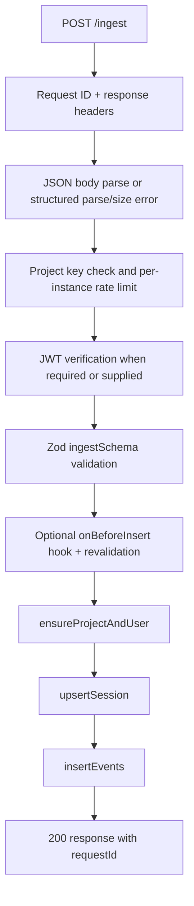

# heat-collector Architecture (`packages/heat-collector`)

## 1) Package purpose

`@m-software-engineering/heat-collector` is an embeddable Express collector that ingests SDK event batches, authenticates requests, validates payloads, persists analytics data to SQL or MongoDB, and serves query endpoints for heatmaps/events/sessions/metrics.

## 2) Runtime model

Runtime composition is centered on `createCollector(config)` in `src/collector.ts`.

Returned runtime components:

- `router`: full router (ingest + api).
- `ingestRouter`: ingestion endpoint(s).
- `apiRouter`: query/metrics endpoint(s).
- `metrics`: in-memory counters.

Startup lifecycle:

1. `createDb(config.db)` resolves adapter + schema.
2. `autoMigrate` runs by default (`autoMigrate ?? true`).
3. Middleware stack assigns request IDs/security headers before JSON parsing, then returns structured errors for malformed or oversized JSON bodies.
4. Routes handle ingest/query flows.

Shutdown behavior:

- No explicit shutdown API exposed by collector. Lifecycle is managed by host app/server process.

External dependencies:

- Express runtime with a `4.22.2` minimum security floor.
- Drizzle ORM for SQL paths with a `0.45.2` minimum security floor.
- MongoDB native driver for mongo paths.
- Optional peer DB drivers depending on dialect; the MySQL2 peer has a `3.23.1` minimum security floor.
- Drizzle dialect-core schema modules use static ESM-compatible imports, while optional database drivers remain dynamically imported by the selected adapter.

## 3) Integration with `heat-sdk`

Data contract and flow:

- SDK sends `POST /ingest` with `x-project-key`, optional `Authorization: Bearer ...`, and payload containing session/user/events.
- Current route code requires `x-project-key` before JWT handling in every auth mode; JWT is required only in `jwt` mode and optional in `both` mode.
- Collector validates with `ingestSchema` (`src/validation.ts`) before persistence.
- `hooks.onBeforeInsert` can transform a valid payload, but its return value is revalidated with `ingestSchema` before any DB write.
- Event semantics expected from SDK:
  - `click`: uses `x/y`
  - `move`: expands `points[]` into row-per-point events
  - `scroll`: stores `scrollDepth`
  - others (`pageview/custom/input/keyboard`) store metadata and can be queried

Dependency direction:

- Collector does not import SDK package; integration is HTTP + schema compatibility.

Error propagation:

- Ingest/query failures return structured JSON payloads with `requestId` and stable error codes.
- Malformed JSON returns `400 invalid_json`; bodies over `ingestion.maxBodyBytes` return `413 payload_too_large`.
- SDK is expected to retry failed ingestion requests.

## 4) Internal architecture

Key modules:

- `src/collector.ts`: route handlers, auth flow, persistence orchestration, event/session query shaping.
- `src/heatmap.ts`: heatmap aggregation in the database (`aggregateHeatmap`), viewport bucket choice, response shape. Dialect backends: `src/heatmap-sql.ts` (Postgres/MySQL/SQLite `GROUP BY` on bucketed coordinates, IEEE-double arithmetic so buckets equal the old Node path) and `src/heatmap-mongo.ts` (aggregation pipelines). `src/meta-json.ts` parses stored `metaJson`.
- `src/db.ts`: adapter factory + auto-migrations/index creation.
- `src/pages.ts` (#25): `GET /api/projects` and `GET /api/projects/:projectId/pages` (keyset cursors as base64url JSON; a pages cursor carries its `from`/`to` so later pages keep the window), plus `pageTitlesOf`/`upsertPageTitles` used by ingest. Backends: `src/pages-schema.ts` (DDL for `autoMigrate`), `src/pages-sql.ts` (one grouped query: distinct (path, session) pageviews in the window, click counts, `LEFT JOIN pages`; projects with correlated 24 h counts) and `src/pages-mongo.ts`. At most 2 queries per request (`pages.test.ts` counts them). The `pages` table holds the latest-seen title per (project, path) (`title_ts` guards against older pageviews; MySQL keys on a SHA-256 of `path`). `autoMigrate` adds `events_project_type_ts_idx` (Postgres: `INCLUDE (path, session_id)`) and `events_project_ts_idx`. `bench/pages-bench.mjs` seeds 10 k pages / 1 M events and gates p95 ≤ 200 ms on Postgres; other dialects report only.
- `src/path-privacy.ts` (#25): `sanitizePayloadPaths` runs on every ingest after the hook: drops a query key whose name, lowercased with `-` and `_` removed, contains `token`, `key`, `secret`, `password`, `passwd`, `auth`, `sig`, `jwt`, `session` or `code` (e.g. `access_token`, `api_key`, `X-Amz-Signature`; rare false positives accepted), or whose value looks like an email; replaces email-looking path segments with `[email]` (so `/users/<email>` is one page). Applies to event paths and pageview `from`/`to`, and trims titles to 200 characters. `GET /api/projects` lists projects with no events first, then by most recent event (keyset on that sort key + id), and returns `projectKey` (admin-only route) so the dashboard can show the snippet. Decisions: Margot on #64.
- `src/schema.ts`: dialect-specific table schemas + CREATE TABLE statements + the `events_project_path_type_ts_idx` heatmap index statement (MySQL uses a `path(255)` prefix and ignores ER_DUP_KEYNAME on re-run).
- `src/validation.ts`: Zod schemas for ingest and query validation.
- `notFoundHandler` (returned by `createCollector`): opt-in JSON 404; deliberately not mounted inside `router` so it cannot shadow host routes.
- `src/http-errors.ts`: `sendError` (wire shape `{ error: HeatError }` + deprecated legacy fields, `Deprecation`/`Link` headers, once-per-process deprecation warning, catalog-driven `Retry-After`, `err` logged as code + cause + internal context with no stack, masked `projectKey`/truncated `ip` in logs, original error logged as `err` only), zod `fieldErrors` and `cause` builders.
- `src/jwt.ts`: RS256 JWT verification and JWKS caching. A token with a `kid` must match that exact key (no first-key fallback). The JWKS URL travels only in the error's non-serialized `internal` context, so it reaches server logs but never the response; every failure throws a `HeatTrackerError` with its own `HEAT_E_JWT_*`/`HEAT_E_JWKS_*` code (HTTP 401), except JWKS download failure: `HEAT_E_AUTH_JWKS_UNAVAILABLE`, HTTP 503 with `Retry-After` taken from the catalog's `retryAfterSeconds`.
- `src/logger.ts`: structured logger with level filtering.
- `src/metrics.ts`: in-memory metrics counters.
- `src/cli.ts`: `heat-collector-migrate` entry for migrations; validates `HEAT_DIALECT` and prints failures as one `formatHeatError` line. `src/cli-errors.ts` builds the `HEAT_E_MIGRATION_FAILED` cause: the innermost driver error class + code + `host:port`, never the connection string. The raw driver message is added only with `--verbose`, after `maskSecrets` removes the URL password (raw and decoded) and `password=` pairs.
- `src/db.ts` setup errors use `HEAT_E_DB_*` codes from `heat-errors`.
- `GET /healthz` (process liveness, no DB) is registered on `router` before the JSON parser and outside `apiRouter`.
- `src/admin-auth.ts`: opt-in `admin.token` guard mounted as `apiRouter.use("/api", …)` (so host routes and ingest are untouched). Missing/malformed `Authorization` → 401 `HEAT_E_ADMIN_TOKEN_MISSING`, mismatch → 401 `HEAT_E_ADMIN_TOKEN_INVALID`; comparison is `timingSafeEqual` over SHA-256 digests.
- `src/projects-api.ts`: `GET /api/projects/by-key/:projectKey` → `{ project: { id, name, createdAt } | null }`, polled by the dashboard onboarding. Projects are still created by their first ingest; `src/project-name.ts` names them after the request `Origin` (http/https origin, else `"Default"`).
- `src/server.ts` (bin `heat-collector`) → `src/server-main.ts`: `serve` (default) reads env (`src/server-db.ts`: `HEAT_DIALECT` default `pg`, `DATABASE_URL` required → `HEAT_E_DB_CONFIG`; DNS lookup first (ENOTFOUND → `HEAT_E_DB_UNREACHABLE`, slow resolvers fall through after the timeout), then one `select 1` round trip with a 5 s pg connect timeout → `HEAT_E_DB_UNREACHABLE`; the pg pool has an `error` listener (`watchPoolErrors`) that logs `HEAT_E_DB_CONNECTION_LOST` at error level instead of crashing on a terminated idle connection, and the pool reconnects on the next query, cause = driver code + host:port via `cli-errors`), validates `HEAT_TRUST_PROXY` (`parseTrustProxy`: boolean, hop count or address list, else `HEAT_E_SERVER_CONFIG`), resolves the admin token (`src/admin-token.ts`: `HEAT_ADMIN_TOKEN` (≥ 32 chars, else `HEAT_E_ADMIN_TOKEN_WEAK`), else `<HEAT_DATA_DIR=/data>/admin-token`, else generated and written 0600 with `wx`; an existing empty file is `HEAT_E_ADMIN_TOKEN_FILE_INVALID`, never overwritten), mounts the collector with permissive CORS on `/ingest` only, listens on `PORT=4000` (`HEAT_E_SERVER_LISTEN` on failure), and prints one boxed startup banner (dashboard URL, collector URL, token, `docker compose exec collector heat-collector token`). Request logs default to `warn` (`HEAT_LOG_LEVEL`). `token` prints the token only (`HEAT_E_ADMIN_TOKEN_STORE` before first start); other commands → `HEAT_E_SERVER_COMMAND`.

Boundary model:

- HTTP boundary (Express route layer).
- Validation boundary (Zod parse + typed query payloads).
- Storage boundary (DbContext abstraction with dialect switch).

## 5) Data collection flow

Event persistence behavior:

- `move` payload points are flattened to multiple event rows.
- `scroll` stores depth as integer.
- input events whose `masked` field contains non-mask characters are dropped as a safety guard.
- metadata JSON stores viewport/device/meta (sanitized to remove text/value/content fields).
- `events.viewport_bucket` stores the event's bucket (`meta.viewportBucket`, else the rounded viewport; `""` when none).
- Each insert also increments `heatmap_rollup` (`src/heatmap-rollup.ts`): one row per (project, path, type, viewport bucket, hour, position) with a count. Positions keep pixel precision (`pos` 0 = none, 1 = x/y, 2 = scroll depth), so bucketing a rollup row gives exactly the raw rows' buckets. Events (marked `rollup_state = 1`) and their rollup increments are written in one transaction (`insertEventsWithRollup`), so a failed rollup write rolls back the events (ingest answers `HEAT_E_INGEST_FAILED`). MongoDB has no rollup yet (#54).
- Migration (`src/heatmap-migrate.ts`, run by `autoMigrate`, re-runnable): adds `viewport_bucket` and `rollup_state`, creates `heatmap_rollup`, then `backfillRollup` counts rows whose `rollup_state` is NULL (written before the rollup existed). Each batch of 5,000 is locked (`FOR UPDATE SKIP LOCKED`; SQLite: an IMMEDIATE transaction), gets its bucket, is upserted into the rollup and marked 1 in one transaction. Ingest marks its own rows, so concurrent ingest and several migrating collectors never double-count (`heatmap-rollup-safety.test.ts`, also on Postgres in CI). To rebuild: empty `heatmap_rollup`, set `rollup_state` to NULL, restart.

Query flow (heatmap):

1. Validate query + parse time range (`viewportBucket`/`viewport` must be `<w>x<h>`, else `HEAT_E_QUERY_INVALID` naming it). Without `from` and `to` the range is the last 7 days ending with the current hour (whole hours); `meta.range` returns `{ from, to, defaulted }`.
2. SQL dialects split the range (`splitRange`): whole hours read `heatmap_rollup` (`SUM(cnt)`), partial edge hours read `events`; every query runs on each part and Node merges the grouped rows.
3. In parallel: max `y` of positioned non-scroll rows and, unless `viewportBucket`/`viewport` is given, the stored buckets of the 10,000 most recent matching events (`VIEWPORT_SAMPLE_SIZE`, always raw) to pick the dominant bucket.
4. Then type counts, per-bucket counts (`meta.viewportBuckets`, ignoring the `viewport` filter), the count of plottable events without a position (`meta.excluded.noCoordinates`, skipped on every database) and one `GROUP BY (bx, by)` query for the grid. No raw event rows reach Node.
5. Default behavior when `type` omitted: request `click`, fallback to `all` when no click rows.
6. Return points (sorted by y, x) and metadata including `totalEvents`, `sampled: false`, plotted/ignored/excluded counts.
7. `src/heatmap.golden.test.ts` pins one recording for every database (equal to the pre-#26 MongoDB path, which already skipped rows without a position) (SQLite always; Postgres/MySQL/MongoDB when `HEAT_TEST_*_URL` is set, as in `.github/workflows/heatmap-db.yml`). `bench/heatmap-bench.mjs` seeds 1 M Postgres events as an older install would hold them, restarts the collector so the migration builds the rollup, warms up for 5 s and gates p95 ≤ 500 ms and flat RSS (nightly and on PRs touching the query).

Query flow (sessions):

1. Validate pagination/user/path/time query parameters.
2. Apply project/user/path/time filters before `limit`/`offset` in both SQL and MongoDB paths.
3. Load per-session event counts and return session metadata.

## 6) Configuration and environment

Config object (`CollectorConfig`):

- `db`: dialect and connection settings.
- `auth`: `projectKey`, `jwt`, or `both`.
- `autoMigrate`, `ingestion.maxBodyBytes`, `ingestion.rateLimit`.
- `hooks.onBeforeInsert`.
- `logging.level`.

CLI/migration env usage in `src/cli.ts`:

- `HEAT_DIALECT` (default `sqlite`)
- `DATABASE_URL`
- `SQLITE_FILE`
- `MONGODB_DATABASE`

Security/ops headers:

- `X-Request-Id`, `X-Heat-Collector`, `X-Content-Type-Options` on responses.
- rate-limit headers on ingest.

Rate limiting:

- Buckets are scoped to each `createCollector` instance and pruned when expired.
- Limits remain process-local and are not shared across server instances.

Secrets handling:

- JWT key material fetched from JWKS endpoint at runtime (cached in-memory).
- DB credentials expected in env/connection strings provided by host app.

## 7) Testing strategy

Discovered tests:

- `src/collector.test.ts`: SQLite integration tests via Express + supertest.
- `src/mongodb.test.ts`: fake Mongo implementation tests migration + API behavior.
- `src/logger.test.ts`: structured warn/error logging and context normalization.
- `src/jwt.test.ts`: malformed-token and unsupported-algorithm rejection.
- Current reliability coverage includes malformed/oversized JSON, per-instance rate limit isolation, hook-output revalidation, and session path filtering before pagination for SQL and MongoDB.
- A distribution smoke test builds the package and initializes in-memory SQLite collectors through both the ESM and CommonJS exports, covering package-loader compatibility that source-level Vitest tests cannot exercise.

Workspace integration coverage:

- `e2e/sdk.e2e.spec.ts` validates SDK-built artifact + collector ingestion/query roundtrip.

Recommended commands:

- `pnpm -C packages/heat-collector test`
- `pnpm -C packages/heat-collector test:coverage`
- `pnpm -C packages/heat-collector typecheck`
- `pnpm -C packages/heat-collector build`
- `pnpm -C packages/heat-collector lint`
- `pnpm -C packages/heat-collector pack:check`

Harness notes:

- Coverage thresholds are enforced in `vitest.config.ts` for collector source files, and Vitest emits `json-summary` coverage for GitHub Actions quality summaries.
- The test harness uses the patched Vitest 4.1 line with its matching V8 coverage provider; the root workspace constrains Vitest's compatible Vite dependency to the patched 6.4 line.
- Package validation uses `publint`, `attw --pack`, and API Extractor against the built `dist` output.
- The package export map splits ESM and CommonJS type resolution, and the migration CLI entrypoint keeps a shebang so packed binaries are executable.

## 8) Extension points

Safe paths:

- Add API route in `apiRouter` + matching schema in `validation.ts`.
- Add ingest pre-processing logic via `hooks.onBeforeInsert` for host-level customization.
- Extend storage fields through `metaJson` for additive metadata without immediate schema churn.

When adding new event types:

1. Update `eventSchema` union.
2. Update `insertEvents` handling.
3. Decide plottable behavior in `src/heatmap-sql.ts` / `src/heatmap-mongo.ts` (and re-record the golden file only for intended output changes).
4. Add tests for ingest + query + fallback behavior.

## 9) Anti-patterns and risks

- **High file complexity**: `collector.ts` is doing too many responsibilities.
- **Process-local rate limiting** (`Map`) is scoped per collector and pruned, but is not horizontally scalable.
- **Potential SQL N+1 in session listing** due to per-session event count query.
- **In-memory JWT/JWKS cache only**; multi-instance systems may fetch keys independently.
- **Unauthenticated query APIs by default**: query routes preserve existing compatibility and rely on host-level protection when exposed outside trusted contexts.
- **`any`-heavy DB abstractions** reduce type safety in persistence code.
- **Harness maintenance burden**: package export maps, CLI packaging checks, API reports, and coverage thresholds now catch more regressions, but require deliberate updates when public APIs or packaging semantics change.

## 10) Coding-agent checklist

Before modifications:

- Inspect `collector.ts`, `validation.ts`, `db.ts`, and `schema.ts` together.
- Confirm SQL and Mongo paths are both covered for behavior changes.
- Check whether response header/error contract is externally relied upon.
- For ingest middleware changes, preserve request correlation before JSON parser errors and structured malformed/oversized-body responses.
- For hook or query changes, preserve hook-output revalidation and SQL/Mongo session path filtering before pagination.

After modifications:

- Run `pnpm -C packages/heat-collector test`.
- If integration behavior changed, run root `pnpm test` (includes e2e).
- Verify auth mode behavior (`projectKey` vs `jwt` vs `both`) if touching ingest auth path.
- Verify referenced file paths/modules in docs remain accurate.
